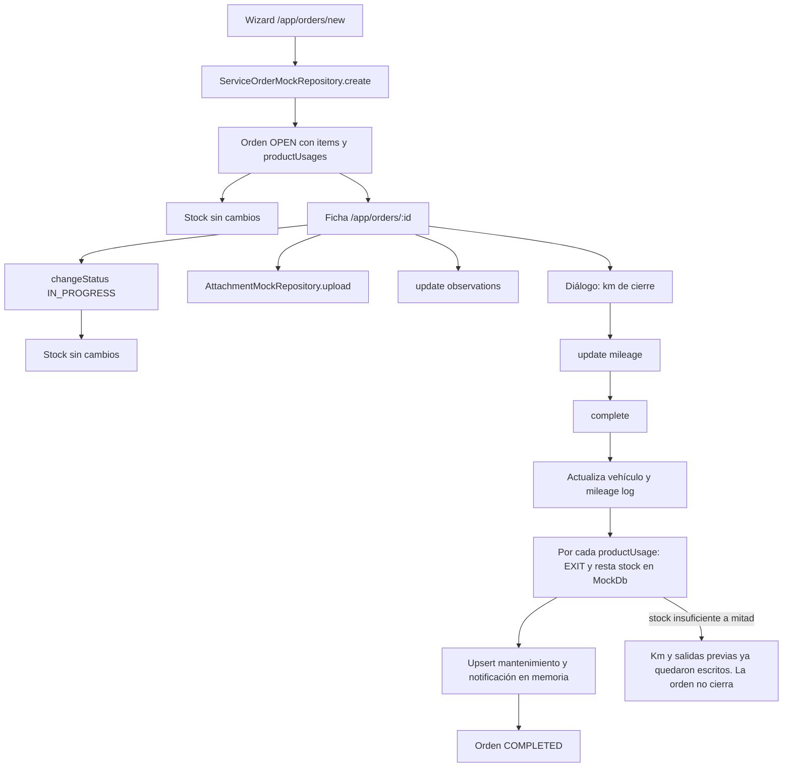
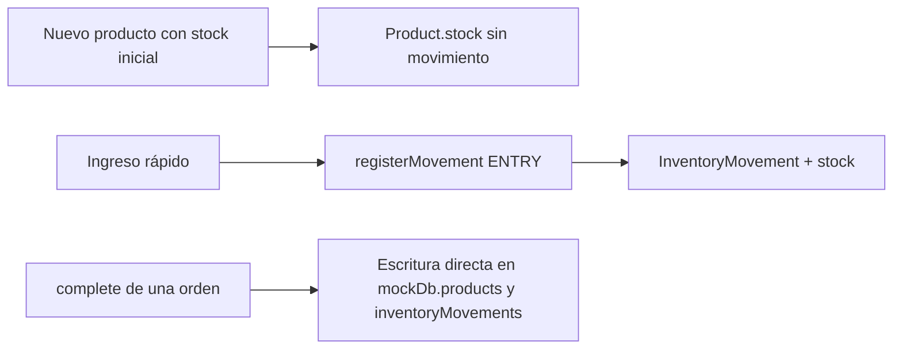
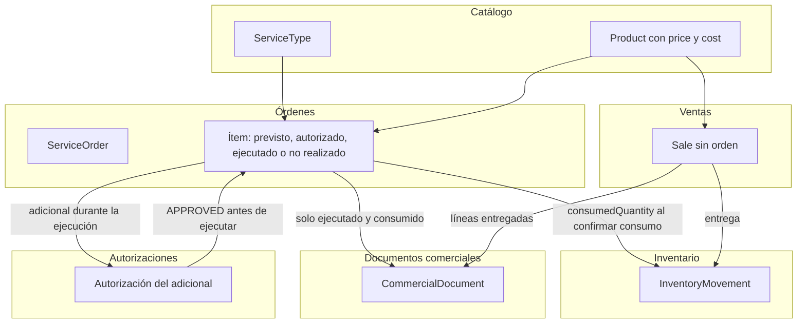
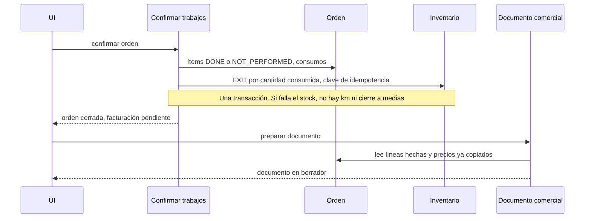

# 03 — Diagramas de proceso

Fecha: 2026-11-02.

## 1. Alta y cierre de orden (comportamiento actual del mock)

La ficha no tiene paso para agregar un servicio ni para marcar un ítem como no realizado. Cancelar una orden abierta no revierte inventario, porque todavía no hubo salida. No se puede cancelar una orden completada, así que las salidas del cierre no tienen reversa en la UI.

## 2. Inventario manual (pantalla actual)

Ajuste, devolución y transferencia existen en `registerMovement` y no tienen pantalla.

## 3. Flujo objetivo (propuesta)

Sigue siendo un solo backend y una sola base, cuando existan. Las cajas son módulos de aplicación, no microservicios.

## 4. Confirmar trabajos (objetivo)

Un caso de uso coordina los módulos dentro de **una** transacción de base de datos para el trabajo y el stock. El documento comercial va en un segundo paso idempotente: si falla el armado de la factura, el taller no se deshace y el paso se puede reintentar. Así se cumple la independencia de responsabilidades sin un bus de eventos.

## 5. Venta directa (objetivo)

No crea `ServiceOrder`. Al confirmar la entrega, inventario registra `EXIT` con `relatedEntityType=SALE`. El documento comercial sale de la venta, no de una orden.

## 6. Qué no cambia

- Cliente, vehículo y flota siguen siendo el contexto de la orden.
- El alta de la orden sigue sin descontar stock.
- Las evidencias siguen siendo `Attachment` sobre la orden.
- SOAT y RTM siguen en `VehicleDocument`, fuera de la facturación.
