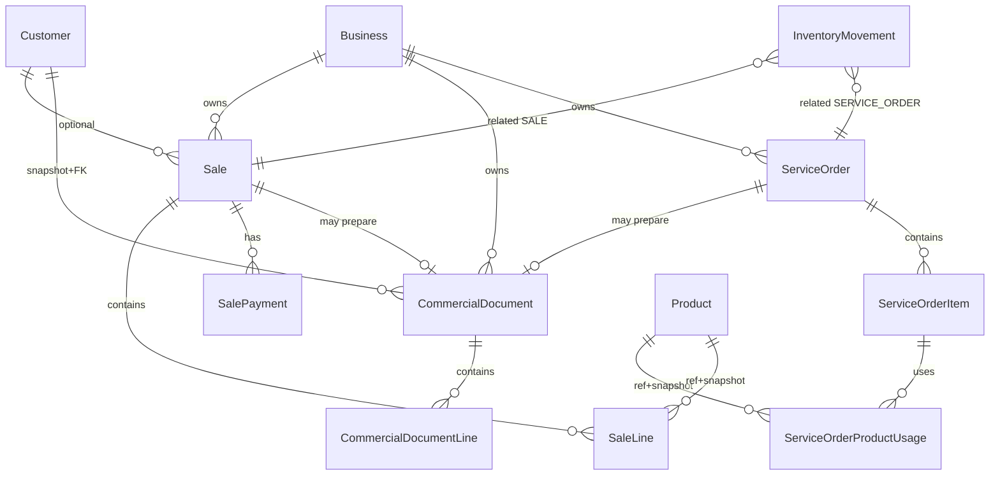

# 12 — Lote 5A: diseño del modelo comercial

| | |
| --- | --- |
| Fecha | 2026-11-16 |
| Estado | **Diseño / contrato propuesto** (sin migraciones Prisma ni pantallas nuevas) |
| Alcance | Sale, CommercialDocument, líneas, snapshots, moneda, estados, multi-tenant, relación con órdenes |
| No incluye | Emisión DIAN, PT, IVA inventado, costos, CxC, pantallas FE, migraciones |
| Fuentes | [11](./11-preparacion-facturacion-electronica.md), [10](./10-ventas-directas.md), [06-DT](./06-decisiones-tecnicas.md), [17-sales](../api-contracts/17-sales.md), [06-orders](../api-contracts/06-service-orders.md), [09-inventory](../api-contracts/09-inventory.md) |
| ADR | [ADR-001](./ADR-001-sale-vs-commercial-document.md) |
| Contrato propuesto | [19-commercial-documents](../api-contracts/19-commercial-documents.md) |

Complementa el doc 11 (restricciones FE) y el mock de ventas (doc 10 / contrato 17). **No** sustituye esos archivos: los consolida en un modelo listo para el Lote 5B (persistencia).

---

## 1. Diagnóstico del modelo actual

### 1.1 Qué existe hoy

| Concepto | Backend (Prisma / Nest) | Frontend |
| --- | --- | --- |
| Producto + `salePrice` | Sí (`Decimal(14,2)`); distinto de stock | `price?` vía adapter HTTP; UI ficha |
| Stock / movimientos | `InventoryStockService` + `InventoryMovement` | Mock + HTTP inventario |
| Cliente | Sí (+ DV/municipio/depto opcionales) | CRUD |
| Vehículo | Sí | CRUD + hoja de vida |
| Negocio (emisor) | `Business` (nombre, taxId, contacto) | Sesión / perfil |
| Órdenes de trabajo | Sí (Lote 4): cabecera, ítems, usages | Mock + HTTP |
| Snapshots en orden | Ítem: `serviceTypeCode/Name`; usage: `productName`, `sku`, `unit`, `unitPrice?` | Mock alineado |
| Venta directa (`Sale`) | **No** en Prisma | Mock completo (contrato 17) |
| Documento comercial | **No** | Placeholder `Sale.billing` (`NOT_REQUESTED`) |
| Precio de servicio | **No** (DT-04 / FE-04 bloqueado) | — |
| Impuestos / IVA | **No** | `taxConfigured: false` |
| Costo / valoración stock | **No** (prohibido doc 11) | `cost?` no persistido |

### 1.2 Histórico vs catálogo vivo

| Dato | Histórico (ya / diseñado) | Catálogo vivo |
| --- | --- | --- |
| Nombre/SKU producto en usage de orden | Snapshot en `ServiceOrderProductUsage` | `Product` |
| Nombre/código servicio en ítem | Snapshot en `ServiceOrderItem` | `ServiceType` |
| Precio en usage | `unitPrice` opcional (puede faltar en órdenes viejas) | `Product.salePrice` |
| Líneas de venta mock | Snapshot completo en `SaleLine` | Producto al agregar línea |
| Cliente en venta mock | `SaleCustomerSnapshot` | `Customer` |
| Cliente en orden | Solo FK; **sin** snapshot comercial de adquirente | `Customer` |

### 1.3 Brechas para operación comercial

1. **No hay agregado persistido de venta** en API (solo mock FE).
2. **No hay `CommercialDocument`**: el cobro consolidado y la futura FE no tienen dueño.
3. **Completar orden ≠ cobro** (correcto por DT-07/DT-08/doc 11), pero falta el paso explícito “preparar documento” desde orden.
4. **Snapshot de cliente ausente en orden** → al emitir documento hay que copiar adquirente en ese momento.
5. **`unitPrice` en usages puede ser null** → riesgo FE: no emitir desde órdenes sin precio histórico (doc 11 §8).
6. **Moneda** solo en venta mock; negocio no tiene `currencyCode`/`currencyScale` canónicos persistidos.
7. **Mano de obra** sin precio de catálogo → líneas de servicio en documento dependen de FE-04.
8. **`Sale.billing` embebido** mezcla operación comercial con hueco tributario; debe externalizarse a documento + capa electrónica futura.

---

## 2. Separación de conceptos (decisión)

### 2.1 Tres capas (doc 11 §2) — sin emitir todavía

```text
1. Operación comercial     Sale (venta directa)  |  ServiceOrder (taller; cobro diferido)
2. Documento comercial     CommercialDocument + CommercialDocumentLine
3. Documento electrónico   (fuera de 5A / 5B) — PT / CUFE / XML
```

### 2.2 ¿Sale y CommercialDocument separados?

**Sí — dos agregados.** Justificación en [ADR-001](./ADR-001-sale-vs-commercial-document.md).

| | `Sale` | `CommercialDocument` |
| --- | --- | --- |
| Rol | Operación de **venta directa** de productos | Documento que **consolida conceptos cobrables** |
| Orígenes | Solo mostrador / mostrador+cliente | `SALE` **o** `SERVICE_ORDER` |
| Borrador editable | Sí (líneas, cantidades, override precio) | Borrador sí; emitido interno **inmutable** |
| Inventario | Confirmar → `EXIT` (dueño: InventoryStockService) | **No** mueve stock |
| Pagos | Sí (`SalePayment`) en el corte mock | Opcional / diferido (no CxC en 5A) |
| Relación con orden | **Ninguna** (DT-07) | FK opcional a orden **o** a venta |

**Alternativa descartada:** unificar todo en `CommercialDocument` con `source=DIRECT`. Obliga a meter confirmación de stock y pagos dentro del documento, o a inventar un “Sale fantasma” por cada orden (rompe DT-07 y duplica consumos).

**`Sale.billing` del mock:** deprecado conceptualmente. Tras 5B, `Sale` apunta a `commercialDocumentId` (nullable hasta preparar documento). Estados DIAN viven solo en capa electrónica futura, no en `Sale`.

---

## 3. Diagrama de arquitectura

```text
┌─────────────┐     complete()      ┌──────────────────────┐
│ ServiceOrder│ ──────────────────► │ InventoryMovement    │
│ + items     │   EXIT consumos     │ (InventoryStockSvc)  │
│ + usages    │                     └──────────────────────┘
└──────┬──────┘
       │ prepare document (explícito; NO en complete)
       ▼
┌─────────────────────┐         ┌──────────────────────────┐
│ CommercialDocument  │◄────────│ Sale (CONFIRMED)         │
│ DRAFT → ISSUED      │ prepare │ EXIT al confirmar        │
│ (+ lines snapshots) │         │ payments                 │
└──────────┬──────────┘         └──────────────────────────┘
           │ futuro
           ▼
┌─────────────────────┐
│ ElectronicDocument  │  (PT / DIAN — no 5A)
└─────────────────────┘
```

Inventario y documento comercial **no** se escriben en el mismo caso de uso obligatorio (DT-03: preparar documento fuera de la TX de confirmación operativa). Pueden encadenarse en aplicación con reintento idempotente (`billingPreparation` / `operationKey`).

---

## 4. Modelo de datos propuesto (sin migrar aún)

### 4.1 Entidades

#### `Sale` (persistir en 5B; contrato base = 17)

Campos esenciales alineados al mock:

- Identidad: `id`, `businessId`, `saleNumber` (único por negocio)
- Estado: `status` (`DRAFT` \| `CONFIRMED` \| `CANCELLED`)
- Pago: `paymentStatus`
- Cliente: `customerKind`, `customerId?`, snapshot embebido o tabla hija
- Moneda: `currencyCode`, `currencyScale`
- Totales: `grossMinor`, `discountMinor`, `taxableBaseMinor`, `taxAmountMinor`, `totalMinor`, `taxConfigured` (siempre `false` hasta FE-02)
- Idempotencia: `confirmOperationId`, `cancelOperationId`
- Documento: `commercialDocumentId?` (FK blanda / misma tenant)
- Auditoría: `createdBy`, timestamps, `confirmedAt`, etc.

`SaleLine`: snapshots `sku`, `productName`, `unit`, precios en minor units, `quantityMillis`, descuentos, `productId` referencial (no para recalcular).

#### `CommercialDocument`

| Campo | Tipo | Notas |
| --- | --- | --- |
| `id` | UUID | |
| `businessId` | UUID | tenant |
| `documentNumber` | string | correlativo interno del taller (no resolución DIAN) |
| `status` | enum | ver §7 |
| `sourceType` | `SALE` \| `SERVICE_ORDER` | origen |
| `sourceId` | UUID | id de Sale u orden |
| `customerId` | UUID? | FK tenant; puede ser null solo si política FE-07 lo permite en borrador |
| `customerSnapshot` | JSON/columns | nombre, tipo/núm ID, DV?, dirección, email, teléfono, municipio?, depto? |
| `currencyCode` | string | p. ej. `COP` |
| `currencyScale` | int | p. ej. `0` para COP demo |
| `issuedAt` | timestamptz? | al pasar a `ISSUED` |
| `voidedAt` / note | | si `VOIDED` |
| `subtotalMinor` | bigint | |
| `discountMinor` | bigint | |
| `taxAmountMinor` | bigint | 0 mientras `taxConfigured=false` |
| `totalMinor` | bigint | |
| `taxConfigured` | boolean | false hasta tarifa real |
| `prepareOperationId` | string? | idempotencia |
| `createdBy` / audit | | |

**Unicidad anti-duplicado:** índice único parcial  
`(business_id, source_type, source_id)` **WHERE** `status IN ('DRAFT','ISSUED')`  
— permite un documento activo por intención; un `VOIDED` no bloquea un reintento legítimo posterior (política FE-05 pendiente para notas).

#### `CommercialDocumentLine`

| Campo | Notas |
| --- | --- |
| `id`, `businessId`, `documentId` | FK compuesta tenant |
| `lineType` | `PRODUCT` \| `SERVICE` \| `OTHER` |
| `sourceLineId` | id de `SaleLine` / usage / item (trazabilidad) |
| `productId` / `serviceTypeId` | opcionales, referenciales |
| `sku`, `description`, `unit` | **snapshot** |
| `quantityMillis` | enteros (misma convención que Sale) |
| `unitPriceMinor`, `discountMinor`, `lineTotalMinor` | snapshot |
| `taxAmountMinor` | 0 si no hay tarifa |
| `position` | orden |

### 4.2 Diagrama entidad-relación



### 4.3 Integridad multi-tenant

- `@@unique([businessId, id])` en cabeceras.
- FK compuestas hijas `(businessId, parentId)` → padre `(businessId, id)`.
- `(businessId, customerId)` → `customers`.
- `(businessId, sourceId)` **no** es FK polimórfica en SQL: validar en dominio según `sourceType`.
- Auditoría en la misma TX de mutaciones que el contrato pida (`COMMERCIAL_DOCUMENT_*`, `SALE_*`).

---

## 5. Relación con órdenes de trabajo

| Regla | Detalle |
| --- | --- |
| Complete ≠ documento | `complete()` solo cierra taller + stock + km/mantenimiento (contrato 06). |
| Complete ≠ Sale | No clonar consumos en una venta (DT-07). |
| Origen de líneas | Usages con consumo efectivo + ítems `DONE`; **no** catálogo vivo. |
| Precio | `unitPrice` del usage (o política: exigir precio al preparar documento). |
| Servicios | Incluir líneas `SERVICE` solo si FE-04/DT-04 aprueba cobro; si no, solo productos. |
| Inventario | Ya movido en complete; preparar documento **no** llama a `InventoryStockService`. |
| Duplicados | Un documento activo por orden (índice §4.1). |
| Vehículo | Opcional en cabecera del documento como metadato (`vehicleId` + placa snapshot); no convierte el doc en `VehicleDocument`. |

Flujo recomendado:

```text
Orden COMPLETED
  → (opcional) billingPreparation = READY
  → POST .../commercial-documents { sourceType: SERVICE_ORDER, sourceId }
  → DRAFT con líneas desde snapshots
  → POST .../issue → ISSUED (interno)
```

---

## 6. Precios, moneda y cálculos

### 6.1 Decisiones vigentes

- Precio producto = `salePrice` / front `price` (doc 11).
- Sin costo ni valoración de inventario.
- Sin precio de mano de obra hasta FE-04.
- Moneda **en el modelo** (`currencyCode` + `currencyScale`), no solo formato UI.
- COP inicial del contexto CO; el modelo admite otros códigos.
- Importes en **unidades menores enteras** (`*Minor`); cantidades en milésimas (`quantityMillis`).
- Prohibido multiplicar dinero con flotantes IEEE en dominio/persistencia.

### 6.2 Fórmulas (escala S = `currencyScale`)

Sea \( q = quantityMillis / 1000 \), precios ya en minor:

1. `lineGrossMinor = roundMoney( unitPriceMinor * quantityMillis / 1000 )`
2. `lineTotalMinor = lineGrossMinor - discountMinor` (≥ 0)
3. `subtotalMinor = Σ lineGrossMinor` (o Σ lineTotal antes de descuento cabecera — **elegir una**; propuesta: descuento solo en línea en 5A, cabecera `discountMinor` = Σ descuentos de línea)
4. `taxAmountMinor = 0` mientras `taxConfigured = false`
5. `totalMinor = subtotalMinor - discountMinor + taxAmountMinor`

`roundMoney`: half-up en la escala de la moneda (COP scale 0 → entero).

### 6.3 Decisiones pendientes (bloquean implementación de cálculo fiscal)

| ID | Tema |
| --- | --- |
| FE-02 | Tarifas / clasificación tributaria |
| FE-04 | ¿Cobrar servicios? |
| M-01 | ¿Descuento a nivel cabecera además de línea? |
| M-02 | Persistir `Business.defaultCurrencyCode/Scale` vs solo copiar al crear Sale/Document |
| M-03 | ¿`salePrice` Decimal(14,2) se convierte a minor con scale del negocio al copiar? (propuesta: sí) |

---

## 7. Estados y ciclo de vida

### 7.1 Sale (operación)

```text
DRAFT ──confirm──► CONFIRMED ──cancel──► CANCELLED
  │                    │
  └──cancel────────────┘ (desde DRAFT: sin stock; desde CONFIRMED: RETURN opcional)
```

- `CONFIRMED` no vuelve a `DRAFT`.
- Confirmar no implica `ISSUED` del documento ni DIAN.

### 7.2 CommercialDocument

```text
DRAFT ──issue──► ISSUED ──void──► VOIDED
  │
  └──void──► VOIDED (si se permite anular borrador)
```

| Estado | Significado |
| --- | --- |
| `DRAFT` | Editable; líneas pueden regenerarse desde origen si aún no se editaron manualmente |
| `ISSUED` | Emitido **internamente**; líneas inmutables |
| `VOIDED` | Anulado interno; no es nota crédito DIAN |

**No** usar estados `PENDING`/`ACCEPTED` DIAN aquí (capa 3–5 del doc 11).

Invariantes:

- `ISSUED` ⇒ snapshots congelados; total = Σ líneas (+ reglas §6).
- No dos documentos activos (`DRAFT`/`ISSUED`) para el mismo `sourceType+sourceId`.
- `VOIDED` no mueve inventario.

---

## 8. Snapshots

Al **confirmar Sale** o al **preparar/issuar documento** desde orden, copiar:

| Origen | Campos copiados |
| --- | --- |
| Producto | sku, name, unit, unitPrice (desde salePrice o override) |
| Servicio (si aplica) | code, name; precio solo si FE-04 |
| Cliente | displayName, ID, DV, contacto, ubicación comercial |
| Negocio | no secretos PT; opcional copia ligera de razón social/taxId en cabecera para PDF interno futuro |

No almacenar credenciales PT, CUFE, XML ni resoluciones en estas tablas (capa electrónica).

No reutilizar `VehicleDocument`.

---

## 9. Preparación FE (respeto doc 11)

Capas 3–5 **fuera de 5A/5B**. Extensiones futuras (solo documentadas):

- `ElectronicDocument` / intentos con idempotencia `businessId+documentId+attemptIntent`
- Resoluciones y numeración autorizada por establecimiento
- Notas crédito (FE-05)
- Tarifas IVA reales (FE-02)

Mientras tanto: `taxConfigured=false`, `taxAmountMinor=0`.

---

## 10. Contratos

| Artefacto | Rol |
| --- | --- |
| [17-sales](../api-contracts/17-sales.md) | Venta directa (mock hoy; HTTP en 5B) |
| [19-commercial-documents](../api-contracts/19-commercial-documents.md) | **Propuesto** documento comercial |
| [06-service-orders](../api-contracts/06-service-orders.md) | Sin cambio de complete; cobro explícito aparte |

---

## 11. Frontend (estrategia)

### 11.1 Modelos

- Conservar `sale.model.ts` como contrato de operación.
- Añadir (cuando 5B) `commercial-document.model.ts` espejo del contrato 19.
- Mapear `price` ↔ `salePrice` sin introducir costo.

### 11.2 Repository + Mock

- `SaleRepository` (ya): mock; HTTP en 5B.
- `CommercialDocumentRepository` (nuevo en 5B): `createFromSale`, `createFromServiceOrder`, `issue`, `void`, `get`, `list`.
- Mock: no tocar stock al crear/issuar documento; leer Sale/orden ya confirmados.
- `provideDataAccess()` elige mock/HTTP sin adapters vacíos (DT-10).

### 11.3 Presentación / navegación (requisitos, no UI en 5A)

- Ventas: módulo existente (`nav.sales`).
- Documento comercial: entrada desde detalle de venta y detalle de orden COMPLETED (“Preparar cobro”), no sidenav profundo.
- Breadcrumbs: Inventario/Órdenes/Ventas → documento.
- No pantalla DIAN.

---

## 12. Riesgos de migración (hacia 5B)

| Riesgo | Mitigación |
| --- | --- |
| Mock `Sale.billing` vs documento real | Migrar lecturas a `commercialDocumentId`; billing embebido solo legacy |
| Órdenes sin `unitPrice` | Bloquear prepare o exigir precio manual con audit |
| Dual writer stock | Sale confirm / Order complete → solo InventoryStockService |
| Unicidad documento | Índice parcial §4.1 |
| Decimales JS | Calcular en minor integers; tests de redondeo |
| Sync contratos FE/BE | SOURCE.md: copiar 12, ADR, 19 a `back-fleet-management` |

---

## 13. Recomendación del siguiente lote (5B)

1. Migración Prisma: `sales`, `sale_lines`, `sale_payments`, `commercial_documents`, `commercial_document_lines` (+ FKs tenant).
2. UC Nest: Sale (espejo 17) + CommercialDocument (19); TX stock solo en confirm/cancel Sale.
3. HTTP repositories FE + tests contrato.
4. UI mínima: preparar documento desde venta confirmada y desde orden COMPLETED; listado documentos.
5. **No** PT/DIAN; **no** IVA inventado; **no** precio servicio sin FE-04.

---

## 14. Criterio de cierre 5A

- [x] Sale vs documento con responsabilidades claras (ADR-001)
- [x] Relación con ServiceOrder definida sin auto-factura
- [x] Líneas + snapshots
- [x] Moneda / precisión / fórmulas
- [x] Estados y transiciones
- [x] Multi-tenant
- [x] Restricciones doc 11
- [x] Contratos coherentes FE/BE (17 + 19 propuesto)
- [x] Decisiones pendientes listadas
- [x] Sin alterar módulos operativos ni migraciones
